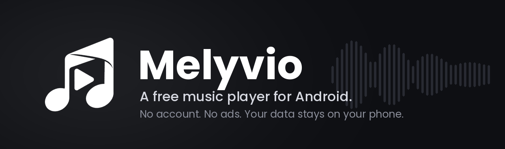
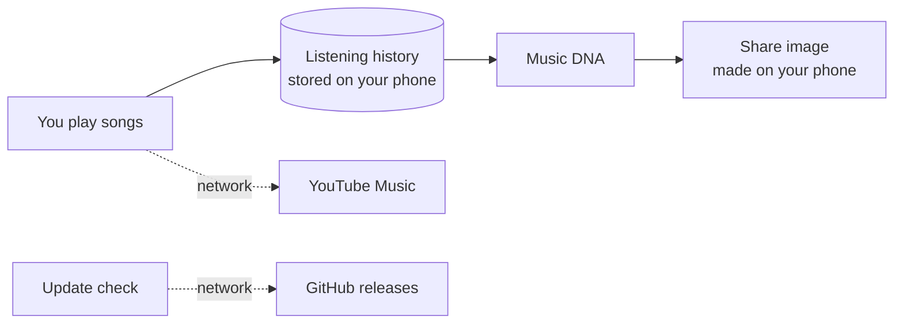
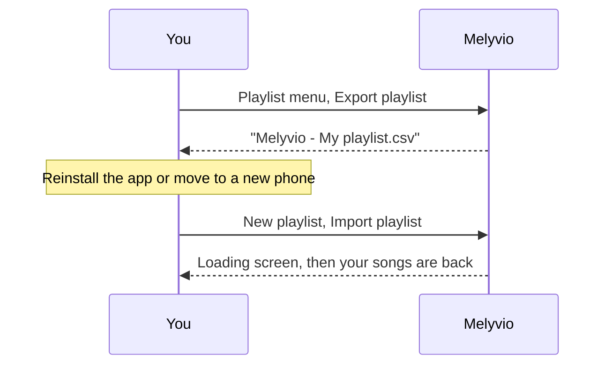

<p align="center">
  
</p>

<p align="center">
  <a href="LICENSE"></a>
  
  
  <a href="https://t.me/rawxtremestudios"></a>
</p>

Melyvio is a music player for Android. It plays music from YouTube Music and never asks you to log in. There are no ads, no tracking and no account to make: open it, search, press play.

The app is free and open source. It started from [Metrolist](https://github.com/MetrolistGroup/Metrolist) (more in [Credits](#credits)) and I keep building my own features on top of it. I work on it alone.

## What Melyvio does

These are the parts I would point to first.

| Feature | What it means |
| --- | --- |
| **Music DNA** | Your top artists, most played songs, favourite genres, listening time for the week, and a "music personality" such as *The Night Owl* or *The Romantic Listener*. Everything is worked out on your phone from your own listening history. You can turn that history off, clear it, and share the result as an image. |
| **Audio booster** | Adds up to 100% extra loudness on top of the phone volume. It shows your phone volume first, then a slider, and it marks a safe range so you know when you are pushing it. |
| **Crossfade** | The next song fades in while the current one fades out. Switch it on from the player menu and choose 3, 5 or 8 seconds. When it is off, songs play normally. |
| **Playlist backup** | Export any playlist to a file made by Melyvio, and import it later when you create a new playlist. After a reinstall or on a new phone you do not have to add your songs one by one. |
| **A home screen that knows the time** | A greeting with your own name and photo, banner slides that start a radio when you press *Play Now*, mood chips, and a Speed dial that turns like the pages of a book. |
| **Glass bottom bar** | A floating, see-through bar with Home, Library and Search. When you scroll down it shrinks, and the song you are playing moves into it. |
| **No account** | Nothing to sign in to. Your library, playlists and history stay on the phone. |

<details>
<summary><b>Everything else</b></summary>

**Listening**
- Search songs, albums, artists, videos and playlists
- Background playback, queue, sleep timer, music alarm
- Offline downloads
- Music recognition (the mic button on the home screen)
- Android Auto and home screen widgets
- Gapless playback, volume normalization, equalizer

**Lyrics**
- Synced lyrics from several sources, with romanization for songs in other scripts
- Share lyrics as a picture

**Library**
- Local playlists with your own banner photo
- Pin playlists to the top
- Liked songs, listening history and stats, yearly Wrapped

**Look and feel**
- Material 3, dynamic colours, light, dark and pure black
- Glass level for the bottom bar and the floating buttons: transparent, soft or frosted
- Optional home banner

**Sound and playback settings**
- Pause when headphones disconnect
- Crossfade and booster settings in the player menu

**Updates**
- The app checks the latest GitHub release and tells you when a new version is out

</details>

## How your data moves

Your history never leaves the phone. The only things that go over the network are the music requests themselves and the update check.



And this is the backup and restore flow:



Only files exported by Melyvio can be imported. If a song is no longer on YouTube Music, Melyvio tries to find it by name, and lists the ones it could not add so you can add them yourself.

## Install

1. Open the [latest release](https://github.com/rawxtreme/Melyvio/releases/latest) and download the `.apk` file.
2. Open the file on your phone. If Android asks, allow installs from this source.
3. Done. Melyvio will tell you when a newer version is out.

Melyvio needs Android 8.0 or newer and runs on 64-bit and 32-bit ARM phones.

## Build it yourself

You can build your own copy. It is free, and the whole thing is in this repository.

**You need**
- JDK 21
- Android SDK with platform 37, plus NDK and CMake from the SDK Manager (the app has a small native part)
- Android Studio, or just the command line

**Get the code and build a test APK**

```bash
git clone https://github.com/rawxtreme/Melyvio.git
cd Melyvio
./gradlew :app:assembleFossDebug
```

The APK is in `app/build/outputs/apk/foss/debug/`.

**Build a release APK with your own signing key**

My signing key is not in this repository and never will be, so a release build needs a key of yours.

1. Create a key once, in a folder outside the project:

   ```bash
   mkdir -p ~/melyvio-keys
   keytool -genkeypair -v -keystore ~/melyvio-keys/melyvio-release.jks \
     -alias melyvio -keyalg RSA -keysize 2048 -validity 10000
   ```

2. Copy `keystore.properties.example` to `keystore.properties` (same folder as `settings.gradle.kts`) and fill in your path, passwords and alias. This file is git-ignored.
3. Build:

   ```bash
   ./gradlew :app:assembleFossRelease
   ```

   The APK is in `app/build/outputs/apk/foss/release/`.

Without `keystore.properties` the release build is signed with your computer's own debug key. That is fine for trying it out, but do not share that APK as a real release.

Keep your `.jks` file and its passwords safe and backed up somewhere private. If you lose it you cannot publish updates for your app.

<details>
<summary><b>Building on a phone, or running out of memory?</b></summary>

Use the Gradle wrapper with fewer workers so the build fits in memory:

```bash
./gradlew :app:assembleFossRelease --no-daemon --max-workers=1
```

</details>

## Make your own version

You are welcome to fork Melyvio and publish your own app, as long as you follow the license below. Before you do, change these so nothing points back to me:

- `applicationId` in `app/build.gradle.kts` (your own package name)
- the app name (`app_name` in `app/src/main/res/values/strings.xml`), the icons and the logo in `app/src/main/res`
- the update checker in `app/src/main/kotlin/com/aaditya/melyvio/utils/Updater.kt` (it reads releases from `rawxtreme/Melyvio`, so point it to your repository)
- the *Connect with developer* and *Buy me a coffee* screens (my Telegram link and my donation QR)

Please use your own name and logo for your version, and keep the credits.

## Privacy and security

- No login, no analytics, no ads
- Listening history stays on your phone. You can pause it or clear it from the Music DNA screen
- Android backup is switched off, so your history is not copied to cloud backups
- All network traffic uses HTTPS
- Playlist imports are checked before they are used: only Melyvio files, a size limit and a strict song id format

Melyvio is an independent project. It is not affiliated with or endorsed by YouTube or Google. All music belongs to its owners.

## Updates and changelog

Big changes are written in [`changelog.md`](changelog.md). The first news about new versions goes to the Telegram channel, before a release is published.

## License

Melyvio is free software under the **GNU General Public License v3.0**. See [`LICENSE`](LICENSE).

In short: you can use it, study it, change it and share it. If you share a changed version, it must also be under GPL-3.0, its source must be available, and the original credits must stay. There is no warranty.

## Credits

Melyvio is built on **[Metrolist](https://github.com/MetrolistGroup/Metrolist)**. Thank you to its developers and to everyone who has contributed to it, including the translators. Music streaming uses InnerTubeX from the same team.

## About me and support

I am **Aaditya Shukla**, an independent Android developer ([@rawxtreme](https://github.com/rawxtreme)).

If Melyvio is useful to you, a star on this repository and a share with a friend help a lot. You can also open **Settings, then Buy me a coffee** inside the app. Thank you.

## Contributions and suggestions

Melyvio is a solo project and I am not looking for contributors right now. Pull requests are turned off. If I want contributors later, I will say so here and on Telegram.

Ideas, suggestions and bug reports are welcome on the Telegram channel. That is also where you hear about new versions first, before a release goes up, so please join:

**[t.me/rawxtremestudios](https://t.me/rawxtremestudios)**

<br>

<p align="center">
  <picture>
    <source media="(prefers-color-scheme: dark)" srcset="assets/readme/wordmark-dark.png">
    
  </picture>
</p>
